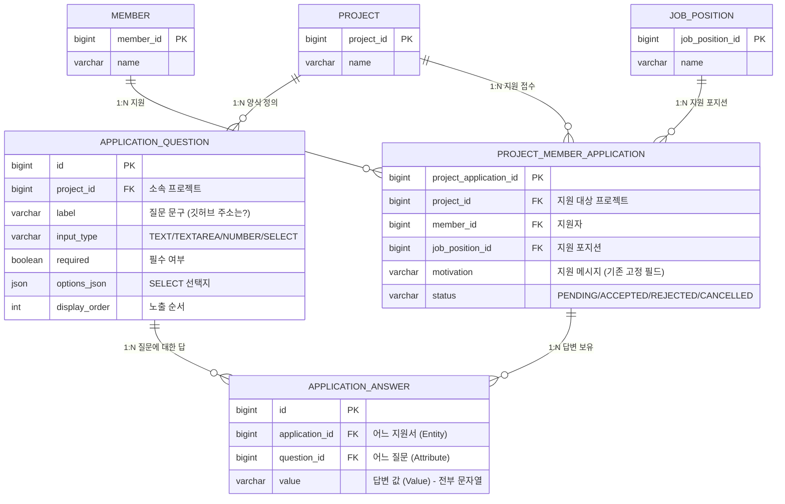
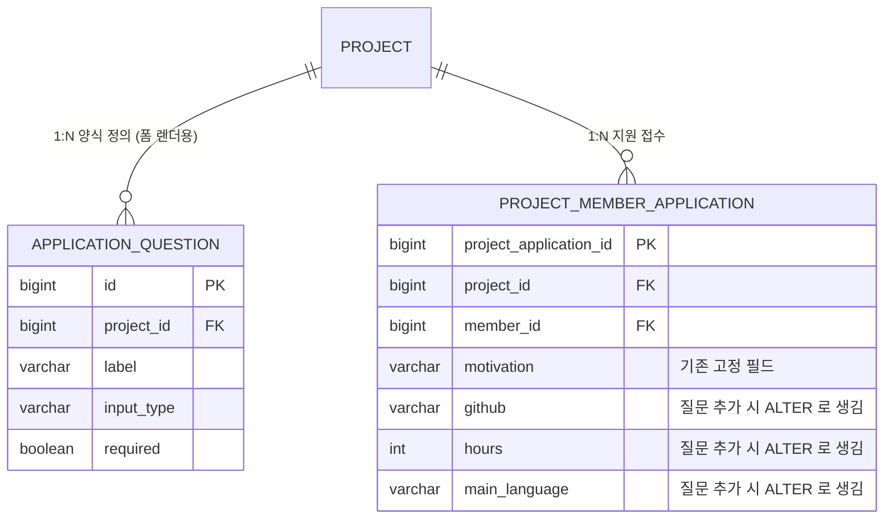

# 동적 지원서 - EAV 설계 (1단계)

> 리더가 프로젝트마다 직접 정의한 **지원서 질문**과, 지원자가 입력한 **답변**을
> EAV(Entity-Attribute-Value) 패턴으로 저장하는 설계 문서입니다.
> 이후 JSON 방식으로 전환하며 EAV의 한계를 비교하기 위한 **1단계** 설계입니다.

---

## 1. 저장 대상 분리

동적 지원서는 성격이 다른 두 데이터를 저장합니다.

| 대상 | 누가 만듦 | 성격 | 저장 방식 |
| --- | --- | --- | --- |
| **질문 (양식 정의)** | 리더 | 검색·검증·재사용 필요 | 관계형 테이블 (`application_question`) |
| **답변 (지원자 입력)** | 지원자 | 질문마다 동적 | **EAV** (`application_answer`) |

질문은 고정 구조라 관계형으로 두고, **동적인 답변만 EAV**로 저장합니다.

---

## 2. ERD (테이블 관계도)



### EAV 매핑 포인트

`APPLICATION_ANSWER` 가 EAV의 핵심 테이블입니다.

- **E**ntity → `application_id` (어느 지원서)
- **A**ttribute → `question_id` (어느 질문)
- **V**alue → `value` (답, VARCHAR 로 통일 저장)

---

## 3. 테이블 상세

### 3-1. `application_question` (질문 = 양식 정의)

리더가 프로젝트를 만들 때 정의하는 질문. **관계형**으로 고정 저장합니다.

```sql
CREATE TABLE application_question (
    id            BIGINT      PRIMARY KEY AUTO_INCREMENT,
    project_id    BIGINT      NOT NULL,
    label         VARCHAR(200) NOT NULL,          -- "깃허브 주소는?"
    input_type    VARCHAR(20) NOT NULL,           -- TEXT/TEXTAREA/NUMBER/SELECT
    required      BOOLEAN     NOT NULL DEFAULT FALSE,
    options_json  JSON        NULL,               -- SELECT 선택지 ["Java","Kotlin",...]
    display_order INT         NOT NULL DEFAULT 0,
    CONSTRAINT fk_question_project
        FOREIGN KEY (project_id) REFERENCES project (project_id)
);
```

### 3-2. `application_answer` (답변 = EAV)

지원자가 입력한 답. **질문 1개당 1행**.

```sql
CREATE TABLE application_answer (
    id             BIGINT       PRIMARY KEY AUTO_INCREMENT,
    application_id BIGINT       NOT NULL,         -- E: 어느 지원서
    question_id    BIGINT       NOT NULL,         -- A: 어느 질문
    value          VARCHAR(500) NOT NULL,         -- V: 답 (문자열)
    CONSTRAINT fk_answer_application
        FOREIGN KEY (application_id) REFERENCES project_member_application (project_application_id),
    CONSTRAINT fk_answer_question
        FOREIGN KEY (question_id) REFERENCES application_question (id),
    CONSTRAINT uk_answer_pair
        UNIQUE (application_id, question_id)       -- 한 질문에 답 1개
);
```

> `uk_answer_pair` 로 "같은 지원서 + 같은 질문" 중복 답변을 막습니다.

### 3-3. `project_member_application` (기존 지원서 - 변경 없음)

기존 지원서 테이블은 그대로 두고, 답변만 `application_answer` 로 연결합니다.
기존 `motivation`(자기소개 한 칸)은 **기본 질문으로 유지**합니다.

---

## 4. 연관관계 정리

| 관계 | 카디널리티 | 방향 | 설명 |
| --- | --- | --- | --- |
| Project — ApplicationQuestion | 1 : N | Project 1개가 질문 N개 보유 | 리더가 만든 양식 |
| Project — ProjectApplication | 1 : N | Project 1개에 지원서 N개 | 지원 접수 |
| Member — ProjectApplication | 1 : N | 회원 1명이 지원 N건 | 지원자 |
| JobPosition — ProjectApplication | 1 : N | 포지션별 지원 | 지원 포지션 |
| **ProjectApplication — ApplicationAnswer** | **1 : N** | 지원서 1개에 답변 N개 | **EAV: Entity 축** |
| **ApplicationQuestion — ApplicationAnswer** | **1 : N** | 질문 1개에 (여러 지원자의) 답변 N개 | **EAV: Attribute 축** |

`ApplicationAnswer` 는 `ProjectApplication` 과 `ApplicationQuestion` 을 잇는
**교차(junction) 테이블이면서 동시에 값(value)을 갖는 EAV 테이블**입니다.

---

## 5. JPA 엔티티 스케치

```java
// 질문 (양식 정의) - 관계형
@Entity
@Table(name = "application_question")
public class ApplicationQuestion extends BaseEntity {

    @Id @GeneratedValue(strategy = GenerationType.IDENTITY)
    private Long id;

    @ManyToOne(fetch = FetchType.LAZY, optional = false)
    @JoinColumn(name = "project_id", nullable = false)
    private Project project;

    private String label;

    @Enumerated(EnumType.STRING)
    private QuestionInputType inputType;   // TEXT/TEXTAREA/NUMBER/SELECT

    private boolean required;

    @JdbcTypeCode(SqlTypes.JSON)
    @Column(name = "options_json")
    private List<String> options;          // SELECT 선택지

    private int displayOrder;
}
```

```java
// 답변 (EAV)
@Entity
@Table(
    name = "application_answer",
    uniqueConstraints = @UniqueConstraint(
        name = "uk_answer_pair", columnNames = {"application_id", "question_id"}
    )
)
public class ApplicationAnswer extends BaseEntity {

    @Id @GeneratedValue(strategy = GenerationType.IDENTITY)
    private Long id;

    @ManyToOne(fetch = FetchType.LAZY, optional = false)
    @JoinColumn(name = "application_id", nullable = false)
    private ProjectApplication application;   // E

    @ManyToOne(fetch = FetchType.LAZY, optional = false)
    @JoinColumn(name = "question_id", nullable = false)
    private ApplicationQuestion question;     // A

    @Column(nullable = false, length = 500)
    private String value;                     // V (전부 문자열)
}
```

```java
// 기존 지원서에 답변 연관관계 추가
@Entity
@Table(name = "project_member_application")
public class ProjectApplication extends BaseEntity {
    // ... 기존 필드 ...

    @OneToMany(mappedBy = "application", cascade = CascadeType.ALL, orphanRemoval = true)
    private List<ApplicationAnswer> answers = new ArrayList<>();
}
```

---

## 6. 실제 데이터 양식 (End-to-End)

실제 서비스에서 데이터가 어떻게 쌓이는지, **두 프로젝트 / 두 지원자** 시나리오로 끝까지 보여줍니다.

### 시나리오

- **프로젝트 3번** (백엔드 스터디) — 리더가 질문 3개 정의
- **프로젝트 8번** (디자인 프로젝트) — 리더가 질문 2개 정의 → **프로젝트마다 양식이 다름**
- 지원자 2명이 프로젝트 3번에 지원

---

### ① `project` (프로젝트)

| project_id | name |
| --- | --- |
| 3 | 백엔드 스터디 |
| 8 | 디자인 협업 프로젝트 |

### ② `member` (회원)

| member_id | name |
| --- | --- |
| 51 | 김희은 |
| 52 | 이지원 |

### ③ `application_question` (리더가 정의한 질문 = 양식)

> 질문은 **프로젝트에 속함.** 프로젝트 3번과 8번의 질문이 서로 다릅니다.

| id | project_id | label | input_type | required | options_json | display_order |
| --- | --- | --- | --- | --- | --- | --- |
| 1 | 3 | 깃허브 주소는? | TEXT | true | `NULL` | 0 |
| 2 | 3 | 주당 참여 시간(h) | NUMBER | true | `NULL` | 1 |
| 3 | 3 | 주 사용 언어 | SELECT | true | `["Java","Kotlin","Python"]` | 2 |
| 4 | 8 | 포트폴리오 링크 | TEXT | true | `NULL` | 0 |
| 5 | 8 | 주 사용 디자인 툴 | SELECT | false | `["Figma","Sketch","XD"]` | 1 |

### ④ `project_member_application` (지원서 - 고정 필드)

> 지원자가 제출한 지원서. 동적 답변은 여기 없고 `application_answer` 로 연결됩니다.

| project_application_id | project_id | member_id | job_position_id | motivation | status |
| --- | --- | --- | --- | --- | --- |
| 7 | 3 | 51 | 11 | 백엔드 깊게 배우고 싶어요 | PENDING |
| 9 | 3 | 52 | 11 | 꾸준히 참여하겠습니다 | PENDING |

### ⑤ `application_answer` (EAV - 동적 답변)

> **지원서 1건 = 질문 수만큼의 행.** 지원서 7번과 9번이 각각 3행으로 쪼개집니다.

| id | application_id | question_id | value |
| --- | --- | --- | --- |
| 100 | 7 | 1 | github.com/heeun |
| 101 | 7 | 2 | 20 |
| 102 | 7 | 3 | Java |
| 103 | 9 | 1 | github.com/jiwon |
| 104 | 9 | 2 | 9 |
| 105 | 9 | 3 | Python |

→ 지원자 2명 × 질문 3개 = **6행**. 지원자 50명이면 **150행**으로 불어납니다.

---

### 데이터 흐름 한눈에 보기

```
member(51) ──┐
             ▼
project_member_application(7) ──┬── answer(100) ──> question(1) "깃허브 주소는?"
   project=3, motivation=...     ├── answer(101) ──> question(2) "주당 참여 시간(h)"
                                 └── answer(102) ──> question(3) "주 사용 언어"
```

한 지원서(7번)가 가진 답변 3행이, 각각 프로젝트 3번의 질문(1·2·3번)을 가리킵니다.

---

### 프론트엔드 ↔ 백엔드 데이터 대응

리더가 생성 폼에서 만든 질문(프론트의 `applicationQuestions`)이 ③ 테이블이 되고,
지원자가 제출한 답변(프론트의 `answers`)이 ⑤ 테이블이 됩니다.

```jsonc
// [리더] 프로젝트 생성 시 전송 → application_question 으로 저장
"applicationQuestions": [
  { "label": "깃허브 주소는?",      "inputType": "TEXT",   "required": true },
  { "label": "주당 참여 시간(h)",   "inputType": "NUMBER", "required": true },
  { "label": "주 사용 언어",        "inputType": "SELECT", "required": true,
    "options": ["Java", "Kotlin", "Python"] }
]

// [지원자] 지원 시 전송 → application_answer 로 저장 (questionId 기준)
"answers": {
  "1": "github.com/heeun",   // question_id 1
  "2": "20",                 // question_id 2
  "3": "Java"                // question_id 3
}
```

> 프론트에서는 질문의 `id`(현재 localStorage 목에서는 문자열 키)를 answers의 키로 쓰며,
> 백엔드 연동 시 이 키가 `application_question.id`(FK)로 매핑됩니다.

---

## 7. EAV의 비용 (2단계 JSON 전환 근거)

이 설계에서 "지원자 목록을 질문별 열로 조회"하려면 **피벗**이 필요합니다.

```sql
-- 프로젝트 3번 지원자들을 질문별 열로 (피벗)
SELECT
    a.application_id,
    MAX(CASE WHEN a.question_id = 1 THEN a.value END) AS github,
    MAX(CASE WHEN a.question_id = 2 THEN a.value END) AS hours,
    MAX(CASE WHEN a.question_id = 3 THEN a.value END) AS language
FROM application_answer a
GROUP BY a.application_id;
```

그리고 "주당 20시간 이상 필터"는 `value` 가 VARCHAR 이라 문자열 비교 버그가 납니다.

```sql
-- 잘못됨: '9' >= '20' 이 참 (문자열 비교)
WHERE a.question_id = 2 AND a.value >= '20';
-- 올바르려면 매번 형변환 (인덱스 못 탐)
WHERE a.question_id = 2 AND CAST(a.value AS UNSIGNED) >= 20;
```

→ **피벗 쿼리 / 문자열 타입 버그 / 행 폭증**이 EAV의 대표 한계이며,
   다음 단계에서 **답변을 JSON 컬럼으로 전환**하여 이를 해소합니다.
   (질문 테이블은 관계형 그대로 유지하는 **하이브리드**)

---

## 부록 A. (비교) 무식한 방식 — 와이드 컬럼

EAV를 쓰기 전, 가장 먼저 떠오르는 "무식한" 방식과 비교합니다.
**답변을 별도 테이블이 아니라 지원서 테이블의 컬럼에 직접 저장**하는 방식입니다.

### A-1. 구조



- **답변 테이블이 없습니다.** 답이 지원서 행의 컬럼에 바로 들어갑니다.
- **질문 테이블(`application_question`)은 여전히 필요합니다.**
  빈 양식을 렌더링하려면 "무엇을 물어볼지"를 알아야 하기 때문입니다. (아래 A-4 참고)

### A-2. DDL

```sql
-- 리더가 질문을 추가할 때마다 지원서 테이블에 컬럼을 추가해야 함
ALTER TABLE project_member_application
  ADD COLUMN github        VARCHAR(200),
  ADD COLUMN hours         INT,
  ADD COLUMN main_language VARCHAR(50);
```

### A-3. 실제 데이터

답변이 지원서와 **같은 행**에 저장됩니다. (지원서 1건 = 1행, 답변 테이블 없음)

| application_id | project_id | motivation | github | hours | main_language | portfolio | design_tool |
| --- | --- | --- | --- | --- | --- | --- | --- |
| 7 | 3 | 백엔드 배우고싶어요 | github.com/heeun | 20 | Java | `NULL` | `NULL` |
| 9 | 3 | 꾸준히 할게요 | github.com/jiwon | 9 | Python | `NULL` | `NULL` |
| 20 | 8 | 디자인 하고싶어요 | `NULL` | `NULL` | `NULL` | behance.net/kim | Figma |

> 프로젝트 3번 질문용 컬럼(github/hours/main_language)과 8번 질문용 컬럼(portfolio/design_tool)이
> **한 테이블에 다 모이고**, 각 지원서는 자기 프로젝트 것 빼곤 전부 `NULL` → **희소 컬럼 폭발**.

### A-4. 양식(빈 폼) 렌더링은?

무식한 방식이라도 **빈 양식은 답변이 아니라 질문 테이블에서** 가져옵니다.
(지원자가 답하기 전이라 답변 컬럼은 비어 있으므로)

```sql
-- 지원자 입장 시: 질문 테이블에서 양식을 읽어 빈 폼을 그림
SELECT label, input_type, required
FROM application_question
WHERE project_id = 3
ORDER BY display_order;
```

→ 폼 렌더링은 EAV/JSON과 동일하게 질문 테이블을 사용하고,
   **답변 저장 위치만** 지원서 컬럼으로 다릅니다.

### A-5. 왜 안 쓰나

| 문제 | 내용 |
| --- | --- |
| ALTER TABLE 지옥 | 리더가 질문 만들 때마다 운영 DB 스키마 변경 (런타임 동적 생성 사실상 불가) |
| NULL 폭발 | 프로젝트마다 질문이 달라 대부분 컬럼이 `NULL` (A-3 참고) |
| 컬럼 수 한계 | 질문 수백 개 → 컬럼 수백 개 |

→ 동적 양식에서는 사실상 불가능하므로 **EAV(본문) 또는 JSON(다음 단계)** 으로 갑니다.

### A-6. 세 방식 한눈 비교

| | 무식 (와이드 컬럼) | EAV (본문) | JSON (다음 단계) |
| --- | --- | --- | --- |
| 답변 저장 위치 | 지원서 테이블 **컬럼** | **답변 테이블** 행 | 지원서 테이블 **JSON 컬럼** |
| 답변 테이블 | ❌ 없음 | ✅ 있음 | ❌ 없음 |
| 질문 테이블 | ✅ 필요 | ✅ 필요 | ✅ 필요 |
| 지원서당 행 수 | 1행 | N행 (질문 수) | 1행 |
| 질문 추가 시 | ❌ ALTER TABLE | ✅ 행 추가 | ✅ 그대로 |
| 양식 렌더링 출처 | 질문 테이블 | 질문 테이블 | 질문 테이블 |

---

## 8. 다음 단계

- [ ] `application_question` / `application_answer` 엔티티·레포지토리 구현
- [ ] 리더 질문 저장 API, 지원자 답변 저장 API
- [ ] 리더용 "지원자 목록 + 질문별 답변 필터" 조회 (EAV 피벗 체감)
- [ ] **JSON 전환** 설계 문서 작성 및 비교
